**I’m a programmer who loves C, writes more Python, and can talk astronomy for hours.**

## `01 / In the garage`

**[Scratchpad](https://github.com/godHUBer/Scratchpad)** started with a question: what if I could open something like Whiteboard but free and opensource, supporting upto 50k people together. The idea was mine and Arena.ai helped me build it.

**First test drive:** Pick a photo with a washed-out sky. Open Curves and pull the bright end of the curve down a little. Compare the sky before and after.

**On the workbench:** I’m making a game for a jam. The idea stays under wraps for now.

## `02 / Under the hood`

   

The Windows 11 calculator annoyed me enough to make me want to write my own. That’s how I pick projects: find something that bugs me, then make the fix usable for the next person, too.

I’ve earned certificates in C, C++, and Python from Aptech India. I still call myself a beginner. AI has helped me get an idea running, but when I’m not sure it’s right, I want a teammate I can reason it through with.

As for my operating system? I’m a certified Linux distro hopper.

## `03 / After hours`

| If you’re into… | Ask me about… |
| :--- | :--- |
| Astronomy | Betelgeuse or TRAPPIST-1e. Either one can keep me talking for hours. |
| Cars & anime | Bunta Fujiwara from *Initial D*. He makes driving look effortless, and he’s the reason for my handle. |
| Making things by hand | Origami and artwork. When I’m not folding or drawing, I like a game of chess. |

---

Fushiwara_codes · end of field log

